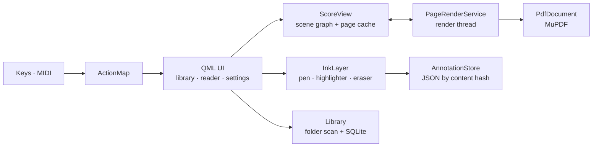

<div align="center">

# 𝄞 OpenScore

**A fast, open-source sheet music reader for Linux.**
Read PDF scores, turn pages with a pedal, mark them up with a pen, and keep a library that always puts what you played last at the top.


</div>

> **Heads up:** OpenScore is at v0.1. The code is complete enough to read end to end, but it has not been compiled yet, so expect a first round of build fixes. There are no screenshots yet either. Issues and pull requests are very welcome.

OpenScore is inspired by [forScore](https://forscore.co) and built for musicians who read from a screen: a pen-friendly, pedal-friendly reader with a library that stays out of your way.

## ✨ Features

| | |
| --- | --- |
| ⚡ **Fast page turns** | MuPDF renders on its own thread and pre-renders the pages around the one you're on into a cache, so a turn is a texture swap. Single-page and two-page views. |
| 🗂️ **Library that mirrors your folders** | Your files stay where you keep them. OpenScore adds titles, composers, page counts, cover thumbnails and history on top. |
| 🕘 **Recents first** | A "Recently viewed" strip sits at the top, and every folder view sorts by recency. A folder counts as recent when anything inside it was opened. |
| 🧭 **Move files freely** | Rename or move a PDF in your file manager and its history and annotations follow, matched by content hash. |
| ✍️ **Annotations** | Pressure-sensitive pen, highlighter, and eraser (including the pen's eraser end), with undo and redo. Ink lives outside your PDF, so originals are never modified. |
| 🦶 **Pedals & MIDI** | Bluetooth page turners that act as keyboards work out of the box. Any key or MIDI message (CC, program change, note) can be re-bound with **Learn**. |
| 🔖 **Picks up where you left off** | Reopening a score returns you to your last page. |

Palm-friendly by design: touch turns pages (left third back, right third forward, middle toggles the toolbars), while only the pen or mouse draws.

## 🦶 Pedals and shortcuts

| Action | Default keys |
| --- | --- |
| Next page | `→` `↓` `PageDown` `Space` |
| Previous page | `←` `↑` `PageUp` `Backspace` |
| First / last page | `Home` / `End` |
| Undo / redo ink | `Ctrl+Z` / `Ctrl+Shift+Z`, `Ctrl+Y` |
| Toggle two-page view | `2` |

Open **Pedals** in the library or reader, press **Learn** next to an action, then step on your pedal or send a MIDI message. MIDI support needs RtMidi at build time.

## 🔧 Build

**Requirements:** Qt 6.5+ (Quick, QuickControls2, Sql, Concurrent), MuPDF, CMake 3.21+, and optionally RtMidi.

```sh
# Debian / Ubuntu
sudo apt install build-essential cmake pkg-config qt6-base-dev qt6-declarative-dev \
                 qml6-module-qtquick-controls qml6-module-qtquick-dialogs \
                 libqt6sql6-sqlite libmupdf-dev librtmidi-dev

cmake -S . -B build -DCMAKE_BUILD_TYPE=Release
cmake --build build -j
./build/openscore               # or: ./build/openscore some-score.pdf
```

The default library folder is `~/Documents/Scores`. Change it any time from **Library folder…**.

## 🏗️ How it works



| Path | What |
| --- | --- |
| `src/PdfDocument.*` | MuPDF wrapper |
| `src/PageRenderService.*` | Render thread with urgent and prefetch queues |
| `src/ScoreView.*` | Scene-graph page view and page cache |
| `src/InkLayer.*`, `src/AnnotationStore.*` | Drawing, erasing, undo, JSON persistence |
| `src/Library.*`, `src/EntryModel.*` | Folder scan, SQLite metadata, recency-first browsing |
| `src/ActionMap.*`, `src/MidiInput.*` | Key and MIDI bindings |
| `qml/` | Library, reader and settings UI |

Data lives in `~/.local/share/openscore/` (library database and annotations) and `~/.cache/openscore/` (cover thumbnails).

## 🗺️ Roadmap

- [ ] Pinch-zoom, crop margins, half-page turns
- [ ] Setlists, tags and a metadata editor
- [ ] Bookmarks and a page index
- [ ] Drag-and-drop into folders
- [ ] Annotation layers and stamps
- [ ] Custom scene-graph ink renderer for even lower pen latency
- [ ] Import from forScore backups
- [ ] Flatpak packaging

## 🤝 Contributing

Build it, break it, and open an issue or a pull request. Early on, the most valuable contributions are build fixes on different distros, testing with real pens and pedals, and screenshots.

## 📄 License

AGPL-3.0-or-later. This is required because [MuPDF](https://mupdf.com) is AGPL-licensed. Add the full license text as `LICENSE` (`curl -o LICENSE https://www.gnu.org/licenses/agpl-3.0.txt`).
